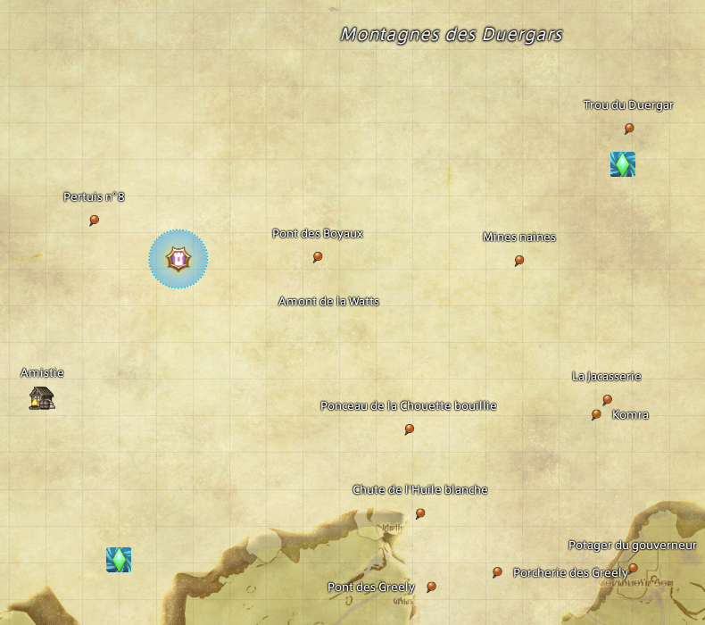

# SimpleAether

A Dalamud plugin for FFXIV that marks the aether currents you haven't unlocked yet on the map, along with the quest givers for any available quest that rewards one.



## Installation

1. In game, type `/xlsettings` and open the **Experimental** tab.
2. Under **Custom Plugin Repositories**, paste this URL, tick **Enabled**, then click **+** and **Save and Close**:
   ```
   https://raw.githubusercontent.com/MaxVlhll/FFXIVSimpleAether/master/repo.json
   ```
3. Type `/xlplugins`, search for **SimpleAether** and install it.

## Usage

Open the map: the missing aether currents show up on it. Marker icons and the vertical offset of quest markers can be changed in the plugin's settings window (`/xlplugins`, then the cog icon).

The markers are drawn as an overlay. The plugin never places in-game map markers and leaves the game's and other plugins' markers alone.

## License

AGPL-3.0, see [LICENSE](LICENSE).
